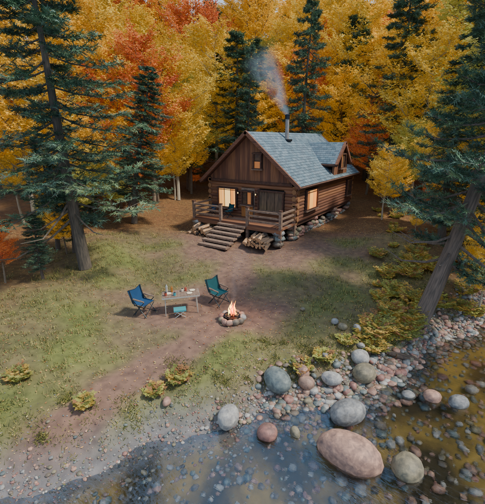

# 秋林溪畔

根据一张秋林小屋照片搭建的 Blender 5.1 场景。相机沿溪岸望向原木小屋，前景的浅溪、火塘、折叠桌椅与门前台阶依次拉开距离。房屋尺寸和照片背面的布局按可见外观估算。



打开 [秋林溪畔.blend](秋林溪畔.blend) 即可编辑。场景包含八个集合，可分别控制建筑、屋顶、门廊、营地、地表、溪流、树林以及烟雾与灯光。树木共享网格，可以单独移动、缩放或旋转。木材、石头、水面和烟雾均使用文件内的程序化材质。

按小键盘 `0` 切换参考机位，按 `F12` 以 Cycles 渲染 1440 × 1496 的竖幅画面。[生成脚本](create_scene.py) 可从仓库根目录运行，重新生成同目录下的模型文件。

```bash
blender -b --python-exit-code 1 -P models/autumn-creek/create_scene.py
```
